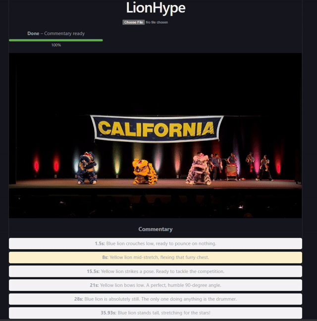

# Maneframe: AI lion dance commentator

Upload a lion dance performance clip and get humorous, time-synced play-by-play commentary, read aloud while the video plays. A local vision LLM watches the footage, edge-tts speaks the lines, and the server schedules them so they never overlap.

Status: v0.1.0, a working local prototype that is being developed into a tool for lion dance teams who turn performance clips into shareable posts (roadmap: `docs/TASKS.md`). It runs end to end with no fake output: if the model or TTS fails, you see an error or a "no audio" notice, never placeholder content.



[Full clip with sound](docs/demo.mp4) (screen recording of the app playing a 40 s clip with generated commentary).

## How it works

```
Browser (React/Vite)                    FastAPI backend                         Local services
  upload ---------------------------->  POST /api/upload  (validate, save, create job)
  progress <---- WS /ws/analyze/{id} -  background pipeline
                                          1 extracting    OpenCV: duration, motion crop box
                                          2 analyzing     10 s windows, 6 frames each ------> llama-server
                                                          (image_url parts, JSON quips) <---- (multimodal Qwen, --mmproj)
                                          3 synthesizing  edge-tts per quip --------------> Microsoft edge-tts (internet)
                                                          mp3 durations (mutagen), schedule so audio never overlaps
  result <---- GET /api/jobs/{id} ----  quips: timestamp, text, audio_url, duration_sec
  plays video + queued audio clips in sync (video ducks while a clip plays)
```

Key design points:
- Motion-based crop: wide stage shots are cropped once per video to where the bright, moving performers are, so the model sees them at useful resolution.
- Windowed analysis: one LLM call per 10 s window, passing the last two quips to avoid repeats.
- Server-side scheduling: an audio line never starts before the previous one ends plus 0.3 s. It is shifted up to 2 s later, otherwise dropped. Lines without audio are still shown.
- Honest failure: a window the model fails on (after one retry) is skipped and reported ("skipped n of m parts" with the time ranges), never filled with invented text; if every window fails the job errors. A failed TTS clip only removes that line's audio.

## Requirements
- Windows (developed natively on Windows 11), Python 3.12, Node 20+ (tested on 24).
- A running llama-server with a multimodal Qwen model and its mmproj file.
- Internet access for edge-tts (an unofficial Microsoft endpoint; needs `edge-tts>=7.3.1`).

## Quickstart (PowerShell, from the repo root)

```powershell
# 1. LLM (separate terminal; adjust paths)
llama-server -m <model.gguf> --mmproj <mmproj-F16.gguf> -c 32768 -np 1 -ngl 99 --port 8080 --jinja

# 2. Backend (first time: create the venv and install)
cd backend
python -m venv venv; venv\Scripts\Activate.ps1; pip install -r requirements.txt   # add requirements-dev.txt to run tests
copy .env.example .env      # optional; every value shown is the default
uvicorn app.main:app --port 8000

# 3. Frontend (another terminal)
cd frontend; npm install; npm run dev     # http://localhost:5173
```
Open http://localhost:5173, choose a clip (`.mp4`, `.mov`, `.avi`; at most 30 min and 2 GB by default, see `MAX_VIDEO_SECONDS`/`MAX_UPLOAD_MB`), wait for the progress bar, press play. When it finishes, "Download video" renders a shareable mp4 (H.264 + AAC, original size, optional captions). Expect minutes of processing: on Qwen3.5-9B a 40 s clip took about 4 minutes (see Benchmarks). Short clips are the supported demo; 40 s is the longest clip measured.

## API

| Route | Purpose |
|---|---|
| `POST /api/upload` (multipart `file`) | Validates and saves the clip, starts a job. Returns `{job_id, filename}`. 400 `{"detail": ...}` on bad input |
| `GET /api/jobs/{job_id}` | `{job_id, status, progress, message, result}`; `result` is `{quips: [{timestamp, text, audio_url, duration_sec}], audio_available}` once completed. 404 if unknown |
| `WS /ws/analyze/{job_id}` | Server to client only: `{status, progress, message?}` with status in `uploading, extracting, analyzing, synthesizing, completed, error`. Sends the current state first, closes after a terminal state; unknown job closes with 4404 |
| `GET /api/jobs/{job_id}/export.mp4?captions=1` | Renders the finished job with ffmpeg and returns an mp4: original audio ducked about 10 dB while a quip plays, quips mixed in at their timestamps, quip text burned in at the bottom when `captions` is 1 (default). Cached per job and captions flag. 409 until completed, 404 if the source video or audio is gone, 500 `{"detail": ...}` if ffmpeg fails |
| `GET /uploads/audio/{job_id}/{file}.mp3` | Generated speech clips. Raw videos are never served |

## Configuration (`backend/.env`, see `backend/.env.example`)

| Setting | Default | Meaning |
|---|---|---|
| `LLM_BASE_URL`, `LLM_MODEL`, `LLM_TIMEOUT`, `LLM_MAX_TOKENS`, `LLM_TEMPERATURE`, `LLM_ENABLE_THINKING`, `LLM_JSON_SCHEMA` | `http://127.0.0.1:8080/v1`, local, 300 s, 500, 0.8, false, true | LLM endpoint and limits |
| `WINDOW_SECONDS`, `FRAMES_PER_WINDOW`, `FRAME_WIDTH` | 10, 6, 896 | Vision windowing |
| `MAX_QUIPS_PER_WINDOW`, `MIN_QUIP_GAP_SEC` | 3, 4.5 | Quip budget (4.5 s is about the speech time of an 8-word line) |
| `TTS_VOICE`, `TTS_RATE`, `TTS_TIMEOUT_SECONDS`, `TTS_CONCURRENCY`, `TTS_RETRIES`, `TTS_RETRY_DELAY_SECONDS`, `TTS_ENABLED` | en-US-GuyNeural, +10%, 30, 1, 1, 1, true | Speech |
| `MAX_SHIFT_SEC` | 2.0 | Largest delay allowed to avoid audio overlap |
| `FFMPEG_PATH`, `EXPORT_TIMEOUT_SECONDS` | bundled, 1800 | ffmpeg for mp4 export: empty uses the binary from `imageio-ffmpeg` (installed by requirements.txt); set a path to use your own |
| `MAX_VIDEO_SECONDS`, `MAX_UPLOAD_MB` | 1800, 2048 | Upload limits (guards, not speed promises) |
| `JOB_TTL_SECONDS`, `JOB_STALE_SECONDS`, `CLEANUP_INTERVAL_SECONDS` | 3600, 1800, 600 | Job expiry; stale-running-job timeout; cleanup interval |
| `CORS_ORIGINS`, `PUBLIC_BASE_URL`, `LOG_LEVEL` | localhost:5173/3000, http://localhost:8000, INFO | Server |

The system prompt is `backend/app/prompts/commentary_system.txt` (restart the backend after editing).

## Tests

```powershell
pytest backend/tests -q          # 164 tests: LLM and edge-tts faked, real tiny videos and a real mp3 for the rest
cd frontend; npm run lint; npm run build
```
Not covered by automated tests: the real model, the real TTS service, browser playback sync (checked by hand, see How it was tested).

## Benchmarks

Measured with `backend/scripts/benchmark.py` on Windows 11, Qwen3.5-9B Q4_K_M via llama-server, default settings, edge-tts 7.3.1. Full data and environment: [`docs/BENCHMARKS.md`](docs/BENCHMARKS.md).

| Clip | Length | Processing | Quips (with audio) | Spoken | Overlaps | Shifted / dropped / TTS failed |
|---|---|---|---|---|---|---|
| shorter_test.mp4 | 4.8 s | 66 s | 1 (1) | 3.2 s | 0 | 0 / 0 / 0 |
| hoco_40s.mp4 | 40.2 s | 251 s | 6 (6) | 22.8 s | 0 | 0 / 0 / 0 |

Run on 2026-10-28 with `LLM_JSON_SCHEMA=true` (the default): 0 unusable-reply retries in 5 model calls, about 54 s per call. The earlier run without the fix needed 3 retries in 9 calls (40 s clip: 299 s). hoco2026.MOV (327 s, 6 GB) was rejected by the default 2 GB upload limit in the earlier run and was not re-run.

## How it was tested
- 164 automated tests (LLM and edge-tts faked; real tiny videos and a real mp3), frontend lint and build.
- One scripted end-to-end run on 3 real clips plus a repeat (table above) against a real llama-server and the real edge-tts service: all 4 accepted jobs finished, with no overlapping audio and no TTS failures in the timeline.
- Browser playback (sync, seek, pause) checked by hand on 2026-10-28 with hoco_40s.mp4 and the final fix: no problems seen.
- Untested: commentary quality (judged by ear and eye only), clips longer than 40 s, the 35B-A3B model, other machines.

## Troubleshooting
- Progress stops and the page says "Live updates lost": on Windows, selecting text in the backend console window (QuickEdit) pauses the server until you press Enter. Press Enter, or turn QuickEdit off in the console properties.
- Job fails with "The AI model rejected the request": llama-server returned an HTTP error (the status is in the backend log); check its console, the model and mmproj files, and `-c`.
- Job fails with "The AI model is not reachable": start llama-server (see Quickstart) and check `LLM_BASE_URL`.
- No audio, "audio unavailable" notice: edge-tts needs internet and `edge-tts>=7.3.1`. Run `python backend/scripts/tts_check.py` (venv active) to synthesize 6 test lines through the app's own TTS code with your current settings; it prints OK/fail with byte sizes, and failures are logged with the exception class, text length, voice, rate and file size. Clips are synthesized one at a time by default (`TTS_CONCURRENCY=1`); "No audio was received" and dropped connections are retried once.
- Every line shows "(no audio)" and the log says "duration unreadable": uvicorn is not running from `backend/venv`. Activate it (prompt shows `(venv)`) and restart.

## Known limitations
- Single user, in-memory jobs, no auth, one job at a time (a second upload gets 409; the LLM server is single-slot). Starting the backend deletes leftover job files (`<job id>_<name>` videos, `<job id>` audio and export folders) in `uploads/`; other files there are left alone.
- Longest clip measured: 40 s (about 4 min of processing). Longer clips, up to `MAX_VIDEO_SECONDS`, are allowed but untested; a 327 s, 6 GB clip was rejected by the default 2 GB upload limit.
- Processing is slow on local hardware: 40 s of video took 251 s (about 6x real time) on Qwen3.5-9B, 54 s per model call on average. Skipped windows leave gaps without commentary; jobs are lost on restart. The 35B-A3B model is unmeasured.
- Speech needs internet (edge-tts). A transient TTS failure is retried once; if edge-tts stays unreachable the app shows the commentary as text with a notice.
- `.avi` and some `.mov` files are accepted by the server but may not play in the browser.
- Runs natively on Windows only; there are no Docker files.

## More
- [`docs/CONVENTIONS.md`](docs/CONVENTIONS.md) contracts and rules, [`docs/DECISIONS.md`](docs/DECISIONS.md) design decisions, [`docs/STATE.md`](docs/STATE.md) what is implemented, [`docs/BENCHMARKS.md`](docs/BENCHMARKS.md) measurements, [`docs/TASKS.md`](docs/TASKS.md) roadmap.
